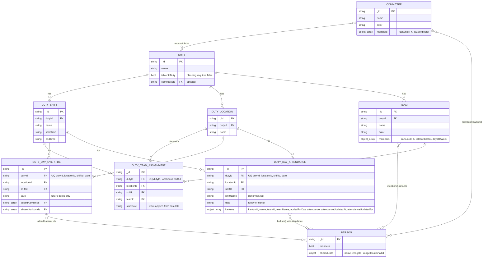

# Duty Planning & Attendance

Data model and rules for duty planning (HR → Duty Planning) and duty attendance (HR → Duty Attendance). Schemas live in `idreesia-common/server/schemas/hr/`; the business logic is in `idreesia-common/server/business-logic/hr/duty-planning.ts`.

Planning is done per **duty location**: a non-mehfil duty plus one of its locations. Future days are planned with a team per shift and per-day changes. At the start of each day, that day's plan is written to a day attendance record and locked. From then on, only attendance can be recorded for it.

---

## 1. ER diagram

All collections are MongoDB, so foreign keys are enforced in application code only. `UQ` notes are unique indexes. Every collection also carries the `identifiable` and `timestamps` fields, which are left out of the diagram.



The planning collections store `dutyId` as well as `locationId`. That's redundant, since a location belongs to one duty, but it lets the code query a whole duty without first looking up its locations.

## 2. Collections

| Entity | Collection | Purpose |
| --- | --- | --- |
| Committee | `hr-committees` | A group of karkuns, some of them coordinators. A committee can be responsible for several duties. |
| Duty | `hr-duties` | A duty, optionally linked to the committee responsible for it. Planning only applies to non-mehfil duties. |
| DutyShift | `hr-duty-shifts` | Shifts belonging to a duty. |
| DutyLocation | `hr-duty-locations` | Locations belonging to a duty. |
| Team | `hr-teams` | A group of karkuns for one duty. Each member can be a coordinator and can be limited to certain weekdays. |
| DutyTeamAssignment | `hr-duty-team-assignments` | The team covering a shift at a duty location, from `startDate` onwards. |
| DutyDayOverride | `hr-duty-day-overrides` | Changes for one future day: karkuns added, or team members marked absent. |
| DutyDayAttendance | `hr-duty-day-attendances` | Who was on duty for a shift at a location on one day, with each karkun's attendance. |

### Team and committee members

Committees use the same shape as teams, without `daysOfWeek`: `members: Array<{ karkunId, isCoordinator? }>`.

```ts
members: Array<{
  karkunId: string;
  isCoordinator?: boolean;  // missing = false
  daysOfWeek?: DayOfWeek[]; // missing = every day; when present, at least one day
}>
```

MongoDB can't enforce one entry per karkun inside an array, so the team mutations guard it. Adding uses `$push` with `{ 'members.karkunId': { $ne: karkunId } }`. Changes use the positional `members.$`, and removal uses `$pull`.

### Day attendance karkuns

```ts
karkuns: Array<{
  karkunId: string;
  name: string;                  // name at the time
  teamId?: string;               // set when the karkun came from the assigned team
  teamName?: string;             // team name at the time
  addedForDay: boolean;          // added through the day's override
  attendance?: 'present' | 'late' | 'absent'; // missing = not marked
  attendanceUpdatedAt?: Date;
  attendanceUpdatedBy?: string;
}>
```

A team member who was also added by hand has both `teamId` and `addedForDay: true`.

## 3. How a day works

Dates are `YYYY-MM-DD` strings compared in Karachi time (`todayInKarachi`).

- **Future dates (after today) are plannable.** Who is on duty is computed live:
  - start with the members of the assigned team who are available that weekday
  - remove the team members the override marks absent
  - add the karkuns the override adds

  A team only counts for dates on or after its assignment's `startDate`.
- **Today and earlier are locked.** Who is on duty is read from the DutyDayAttendance record. The server refuses plan changes for these dates by comparing dates, so the lock doesn't depend on the nightly job.
- **Creating day attendance records** (`lockDays`). A record is written for a date only when a plan applies to it, meaning a started team assignment or an override. The record's list can be empty. Inserts are safe to repeat because of the unique index. Records are written:
  - by the job `create-duty-day-attendances` ("Create Duty Day Attendances", 00:05) for today
  - when a locked date is read and has no record yet, for example because the job didn't run or the server's clock is behind Karachi
  - before attendance is marked
  - before a plan change that would alter locked days (see below)
- **Plan changes**
  - **Setting a shift's team:** the days the old team already covered are locked first. The new team starts tomorrow.
  - **Day overrides:** only accepted for dates after today.
  - **Team member changes** (add or remove a member, change their days): the days the team already covered are locked first, so the change only affects future days. Coordinator changes don't affect planning.
- **Attendance** is set on a karkun's entry in the day's record, so a mark can only exist for someone who was on duty that day. Clearing a mark removes the attendance and audit fields.
- **Delete guards**
  - A shift or location can't be deleted while it has a team assignment or an override dated after today.
  - A team can't be deleted, or moved to another duty, while it's assigned.
  - A committee can't be deleted while a duty names it as responsible.
  - Day attendance records are history and don't block deletes.
- **Person delete** removes the person from committee members, team members and day attendance records, and counts all three in the person's relation counts.

## 4. Open points

- **Editable dates differ.** The server accepts attendance for any locked date (today and earlier); the UI only edits today.
